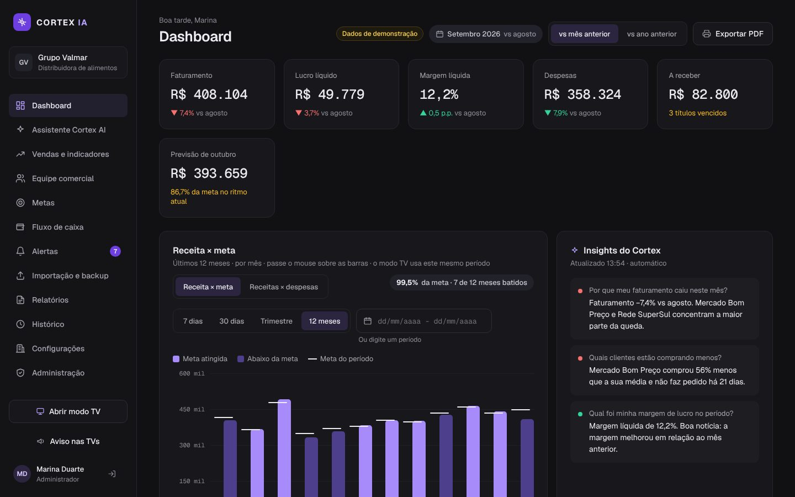
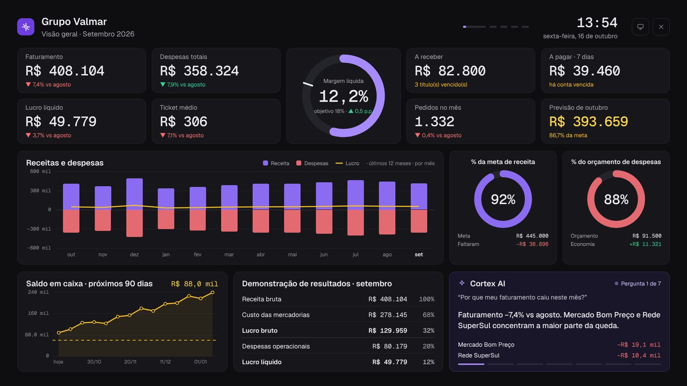

# CORTEX IA

Dashboard empresarial que roda **no próprio computador**: indicadores financeiros e de vendas, metas, fluxo de caixa, alertas, modo TV para o escritório e um assistente de IA local (Ollama) que responde perguntas sobre os números da empresa. Nenhum dado sai da máquina.

> **Vai instalar numa empresa?** Siga o [guia de instalação passo a passo](docs/GUIA-INSTALACAO.md) — sem terminal, com primeiro acesso, importação dos dados, TVs e IA.





## O que tem

| Área | O que faz |
|---|---|
| **Dashboard** | Faturamento, lucro, margem, despesas, a receber e previsão do mês; gráfico Receita × meta ou Receitas × despesas; comparação com o mês anterior ou com o ano anterior; exportação em PDF |
| **Assistente** | Perguntas em português (“por que o faturamento caiu?”). As frequentes têm resposta automática; com a IA local, responde perguntas livres. Mini gráficos, leitura em voz alta e ditado pelo microfone |
| **Vendas e clientes** | Faturamento diário, categorias, curva ABC de produtos, tabela de clientes e página de cada cliente (compras mês a mês contra o ano anterior, frequência, produtos que caíram) |
| **Equipe comercial** | Ranking dos vendedores contra a meta individual, com o traço de onde deveriam estar hoje; regiões e destaques da semana |
| **Metas** | Por mês, por vendedor e por categoria, com previsão de fechamento no ritmo atual; **orçamento de despesas** por categoria |
| **Fluxo de caixa** | Saldo projetado em 30, 60 ou 90 dias a partir de contas a pagar e receber e da média de vendas; aviso quando o saldo fura o mínimo; baixa de contas |
| **Alertas** | Cliente fora do ritmo de compra, meta em risco, saldo abaixo do mínimo, contas vencidas, orçamento estourado e produto em queda; resumo diário por e-mail (Gmail); selecionar e apagar alertas |
| **Modo TV** | Telas que giram sozinhas (visão geral, ranking, vendas, clientes, financeiro, insights); telas diferentes por TV; aviso fixo no topo com prazo |
| **Importação e backup** | Planilhas .xlsx/.csv (um arquivo com várias abas, vários arquivos ou uma pasta inteira) com reconhecimento automático das colunas; quadro “Dados da empresa” mostrando o que já foi enviado e o que falta; pasta monitorada com a situação de cada arquivo; backup diário e restauração |
| **Relatórios e histórico** | Relatórios executivo, DRE, produtos, clientes e caixa, com PDF e agendamento; histórico de tudo o que aconteceu; seleção e exclusão em lote (relatórios antigos e histórico) |
| **Acesso e auditoria** | Login por organização, foto da organização (menu, login e TV), quatro papéis com permissões ajustáveis, troca de senha obrigatória no primeiro acesso e auditoria com IP |

## Instalação

**Windows, sem terminal** (para quem vai usar): instale o [Node.js LTS](https://nodejs.org/pt/download), baixe o projeto em **Code › Download ZIP**, extraia numa pasta fixa (ex.: `C:\Cortex`) e dê dois cliques em **`instalar.bat`**. Detalhes no [guia de instalação](docs/GUIA-INSTALACAO.md).

**Pelo terminal** (para desenvolver), com Node.js 20 ou mais novo:

```bash
npm install
npm start
```

Abra **http://localhost:3210** e entre com a conta de demonstração:

| Organização | E-mail | Senha |
|---|---|---|
| `grupo-valmar` | `marina@grupovalmar.com.br` | `cortex2026` |

Na primeira execução o Cortex cria o banco (`data/cortex.db`) com 2 anos de dados de uma empresa fictícia. Na primeira importação de planilha, esses dados são substituídos pelos seus.

### Atualizar

Numa instalação feita com `git clone`, na pasta do Cortex:

```bash
git pull
instalar.bat      # para o Cortex, atualiza as dependências e inicia a versão nova
```

Instalado por ZIP: baixe o ZIP novo, copie por cima da pasta do Cortex e rode o `instalar.bat` de novo. A pasta `data` (dados e backups) não é tocada.

### Iniciar junto com o Windows

```bash
npm run windows:instalar            # sobe sozinho ao ligar o PC + atalhos na Área de trabalho
npm run windows:instalar -- --tv    # idem, e já abre o modo TV em tela cheia (PC da TV)
npm run windows:remover             # desfaz
```

O `instalar.bat` faz isso automaticamente. O Cortex roda escondido; o registro fica em `data/cortex.log`.

### Modo TV

- No próprio computador: `npm run tv` ou `http://localhost:3210/tv`.
- Em outra TV ou PC da rede: o endereço “Na rede (TVs)” que aparece no terminal + `/tv` (ex.: `http://192.168.0.10:3210/tv`).
- Instale o Cortex em **um computador só**; cada instalação tem o seu próprio banco de dados.

Em **Configurações › Modo TV › TVs cadastradas** cada TV ganha nome e telas próprias (link `/tv?tela=<id>`). O botão **Aviso nas TVs** publica um recado no topo das telas.

## IA local (Ollama) — opcional

O Cortex funciona sem IA: as perguntas frequentes (queda do faturamento, produtos, clientes, margem, comparação, relatório da semana, atenção, caixa e vendedores) têm **respostas automáticas** calculadas pelo sistema. A IA serve para **perguntas livres**, escritas do seu jeito.

A IA roda **no seu computador**, pelo [Ollama](https://ollama.com) — um programa gratuito. Não tem mensalidade nem cobrança por uso, e os dados da empresa não saem da máquina.

**1. Instale o Ollama**

| Sistema | Como instalar |
|---|---|
| Windows | Baixe o instalador em [ollama.com/download](https://ollama.com/download) e execute. Ele fica rodando sozinho em segundo plano (ícone perto do relógio). |
| macOS | Baixe em [ollama.com/download](https://ollama.com/download), arraste para Aplicativos e abra uma vez. |
| Linux | `curl -fsSL https://ollama.com/install.sh \| sh` |

**2. Baixe o modelo** (uma vez só; abra o PowerShell ou o Terminal):

```bash
ollama pull qwen2.5:7b
```

**3. Confira:** abra o **Assistente** no Cortex. O selo do topo deve mostrar **“Ollama · qwen2.5:7b · local”**. Em **Configurações › Cortex AI › Testar conexão** aparece a velocidade (tokens por segundo).

**Qual modelo escolher**

| Modelo | Download | Memória livre | Quando usar |
|---|---|---|---|
| `qwen2.5:3b` | ~2 GB | 4 GB | Computador mais simples; responde rápido, entende um pouco pior |
| `qwen2.5:7b` | ~4,7 GB | 8 GB | **Recomendado** |
| `qwen2.5:14b` | ~9 GB | 16 GB | Respostas melhores; ideal com placa de vídeo |

Para trocar: `ollama pull <modelo>` e depois mude o nome em **Configurações › Cortex AI**. Sem placa de vídeo cada resposta pode levar de 20 s a 1 min — é normal.

**Problemas comuns**

- *“IA offline · respostas automáticas”*: o Ollama não está aberto. No Windows, abra o Ollama pelo menu Iniciar; no Linux/macOS rode `ollama serve`.
- *“Modelo … não instalado”*: rode `ollama pull` com o nome exato que está em Configurações.
- *Muito lento*: use o `qwen2.5:3b` ou feche programas pesados.
- *Ollama em outro computador da rede*: em Configurações, troque o endereço `http://localhost:11434` pelo IP daquela máquina (lá, inicie o Ollama com a variável `OLLAMA_HOST=0.0.0.0`).

**Usar sem IA (empresa que não permite):** em **Configurações › Cortex AI**, desligue **“Usar inteligência artificial”**. O Cortex para de se conectar ao Ollama, o Assistente vira **Perguntas rápidas** (só respostas automáticas), o microfone some e a TV mostra “Destaques” em vez de “Cortex AI”.

**Gráficos e voz:** as respostas trazem um mini gráfico quando ajuda (queda, comparação, produtos, clientes, margem, caixa). No Chrome/Edge dá para falar a pergunta pelo microfone (o áudio é transcrito pelo serviço do navegador, então precisa de internet) e ouvir as respostas (vozes do sistema, funciona offline).

**Como a IA funciona:** ela nunca faz contas. O modelo escolhe uma “ferramenta” (`comparar_periodos`, `top_produtos`, `clientes_em_queda`…), o Node calcula os números no SQLite e a IA só explica o resultado.

## Seus dados

Para começar, use o **[`exemplos/cortex-modelo-geral.xlsx`](exemplos/cortex-modelo-geral.xlsx)**: uma planilha só, com as abas Vendas, Despesas, Contas e Metas, linhas de exemplo e uma aba *Como preencher*. Na mesma pasta há o `cortex-exemplo-dados.xlsx` (três meses de uma empresa fictícia, com uma aba *Resumo* mostrando como o lucro é calculado) e os mesmos dados em arquivos separados (`1-vendas`, `2-despesas`, `3-contas`, `4-metas`).

| Planilha | Colunas obrigatórias | Recomendadas |
|---|---|---|
| Vendas (uma linha por item) | Data, Valor (unitário ou total) | **Custo unitário** (sem ele, o custo é estimado em 70% do preço e o lucro fica aproximado), Cliente, Produto, Quantidade, Pedido, Categoria, Vendedor, Região |
| Despesas | Data, Valor | Categoria, Descrição |
| Contas a pagar/receber | Tipo, Parceiro, Vencimento, Valor | Pago em |
| Metas | Meta | Mês (sem ele, vale o mês atual), Vendedor ou Categoria; também aceita um mês por coluna (Jan, Fev, Mar…) |

- **Importar planilha** (Importação e backup): envie um arquivo com várias abas, vários arquivos de uma vez ou uma pasta inteira. O Cortex reconhece o tipo de cada um, acha o cabeçalho mesmo abaixo de títulos do relatório, ignora linhas de total e mostra o que vai completar (ex.: venda sem cliente entra como “Cliente não informado”). Se não reconhecer um arquivo, use **Ajustar colunas** ao lado dele.
- **Dados da empresa:** o quadro na mesma tela mostra quais dos quatro tipos já foram enviados, até quando vão os dados e o que deixa de funcionar sem os que faltam.
- **Importação automática:** aponte a pasta onde o sistema da empresa exporta; os arquivos novos entram sozinhos, sem duplicar pedidos, e a tela lista cada arquivo da pasta (importado, com erro ou novo).
- **Backup:** automático todo dia (horário e pasta configuráveis — use um pendrive ou HD externo), manual em um clique e restauração pela mesma tela.
- **Dados atrasados:** se as vendas importadas terminam antes de hoje, alertas e relatórios contam a partir da última venda e avisam até quando vão os dados.

## Comandos

| Comando | O que faz |
|---|---|
| `npm start` | Compila a interface (quando o código muda) e sobe o servidor |
| `npm run dev` | Modo desenvolvimento (Vite + servidor com reload) |
| `npm run tv` | Abre o modo TV em tela cheia |
| `npm run seed` | Recria os dados de demonstração |
| `npm run org:create -- --slug minha-empresa --name "Minha Empresa" --admin "Nome" --email voce@empresa.com --password senha1234` | Cria outra organização com login próprio |
| `npm run windows:instalar` | Inicia o Cortex com o Windows e cria atalhos (`-- --tv` abre a TV junto) |
| `npm run benchmark` | Teste de carga: cria uma empresa grande num banco separado e mede o tempo de cada tela |
| `npm test` | Testes automatizados (inclui a IA com um Ollama simulado) |

## Segurança e auditoria

- Senhas guardadas com scrypt; sessão por cookie com validade configurável.
- Usuários convidados (ou com senha redefinida pelo administrador) entram com uma senha temporária e são obrigados a criar a própria senha no primeiro acesso.
- **Histórico › Auditoria** mostra acessos, tentativas de login com senha errada, mudanças de usuários e permissões (com o antes e depois), configurações, importações e avisos na TV, com o IP de cada ação. Exporta em CSV.
- Só administradores apagam itens do histórico; acessos e mudanças de permissão nunca são apagados, e cada exclusão fica registrada.
- A senha de app do Gmail fica só no banco local e nunca volta para a tela.

## Estrutura

```
server/            Express + SQLite (better-sqlite3)
  index.js         rotas da API e servidor
  db.js            banco, migrações e configurações por organização
  auth.js          login, sessões e permissões
  metrics.js       cálculos: faturamento, margem, curva ABC, metas, previsão
  customers.js     tabela e detalhe de clientes
  team.js          equipe comercial, regiões e destaques
  cashflow.js      fluxo de caixa projetado
  alerts.js        regras de alerta
  answers.js       respostas automáticas das perguntas frequentes
  charts.js        mini gráficos das respostas
  ai.js            Ollama com tool calling
  mailer.js        resumo diário por e-mail
  importer.js      leitura e importação de planilhas
  backup.js        backup e restauração
  services.js      agendador, insights, relatórios e canal ao vivo da TV
client/src/        React + Vite (telas do app e modo TV)
scripts/           início com o Windows, modo TV, build e teste de carga
test/              testes automatizados (node --test)
exemplos/          planilhas fictícias para testar a importação
docs/              guia de instalação e imagens
instalar.bat       instalador de duplo clique para Windows
data/              banco local, backups e log (não vai para o Git)
```

Variáveis opcionais: `PORT` (padrão 3210), `HOST` (padrão `0.0.0.0`, para as TVs da rede acessarem), `CORTEX_DATA_DIR` (onde ficam banco, backups e log).
